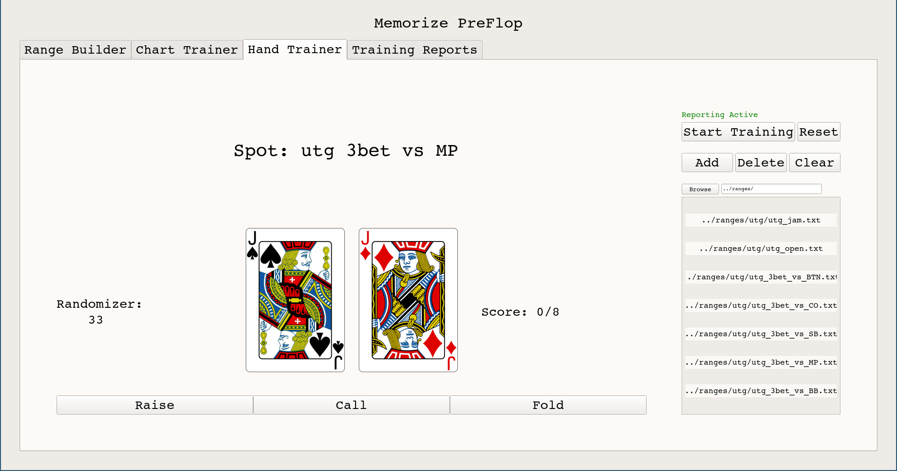
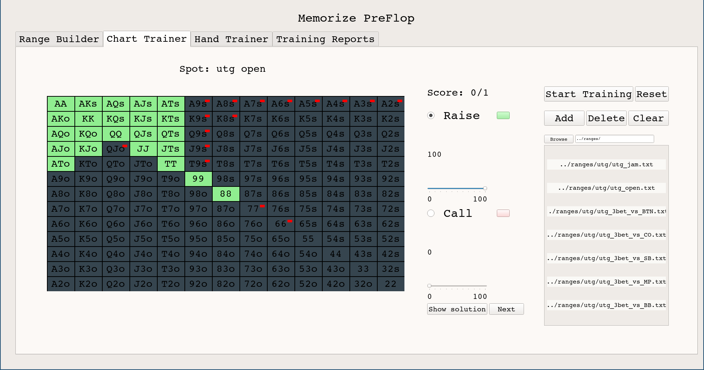
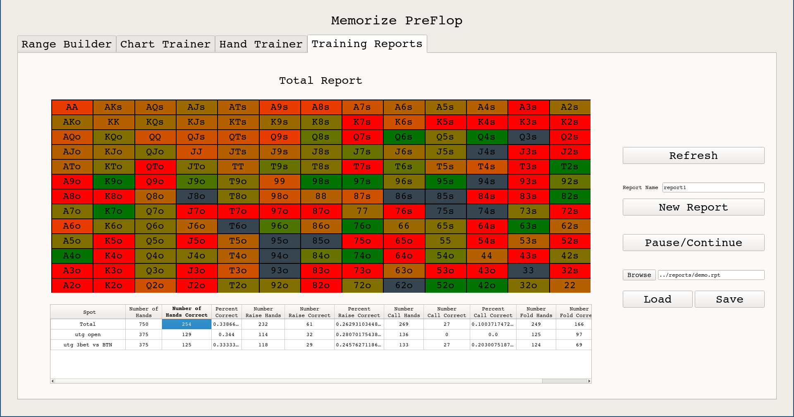

# Memorize PreFlop

Memorize Preflop is a simple tool for memorizing preflop ranges. It has a range builder, a chart trainer, hand traininer, and custom reporting system. It allows for users to custom train any set of ranges from both a chart and hand persepective. Feel free to checkout the demo video here: <a href="https://www.youtube.com/watch?v=jHXeO7m5CgQ"> Youtube </a>


 







# Usage Demo
Please checkout this youtube <a href="https://www.youtube.com/watch?v=jHXeO7m5CgQ"> video</a> for a simple example on how Memorize Preflop can be used!

# Installation

Prebuilt binaries live in the [`builds/`](builds/) folder. They are produced by
the **Build binaries** GitHub Actions workflow ([`.github/workflows/build.yml`](.github/workflows/build.yml)),
which builds Windows, macOS and Linux natively (PyInstaller cannot
cross-compile) — run it from the Actions tab or push a version tag to
regenerate fresh binaries for all three platforms. You can also build any of
them yourself with `python build.py` on the matching OS.

## Windows

Download **[MemorizePreflopWindows.zip](https://raw.githubusercontent.com/lukebhan/memorizePreFlop/main/builds/MemorizePreflopWindows.zip)**, extract the folder, and run the file titled `MemorizePreflop`. That's it.

## MacOS

### (a) Download the binary (recommended)
Download **[MemorizePreflopMacOS.zip](https://raw.githubusercontent.com/lukebhan/memorizePreFlop/main/builds/MemorizePreflopMacOS.zip)**, extract it, open the `MemorizePreflop` folder, and run `MemorizePreflop`. The build is unsigned, so on first launch right-click the executable and choose **Open** to get past Gatekeeper. (This binary targets Apple Silicon; on an Intel Mac, build from source below.)

### (b) Build from source
Building from source only needs Python, Numpy and PyQT5:
1. Install python through Anaconda <a href="https://www.anaconda.com/products/distribution"> Anaconda Install </a>
2. Open your terminal in finder. On Mac, press command space bar and search terminal.
3. (Optional) Create a virtual env: ```conda create -n memorizePreflop python=3.8```
4. Install Dependencies:
  a) ```conda install PyQt```
  b) ```conda install numpy```
5. Download the source. The easiest way is through git: ```git clone https://github.com/lukebhan/memorizePreFlop.git```
6. Navigate to folder. ```cd memorizePreFlop/src```
7. Run the application ```python sol.py```

## Linux

### (a) Download the binary (recommended)
Download **[MemorizePreflopLinux.zip](https://raw.githubusercontent.com/lukebhan/memorizePreFlop/main/builds/MemorizePreflopLinux.zip)** (attached to the [latest Release](https://github.com/lukebhan/memorizePreFlop/releases/latest) and produced by CI), extract it, open the `MemorizePreflop` folder, and run `MemorizePreflop`.

### (b) Build from source
Identical to the macOS source steps above (Python, Numpy and PyQT5):
1. Install python through Anaconda <a href="https://www.anaconda.com/products/distribution"> Anaconda Install </a>
2. Open a terminal.
3. (Optional) Create a virtual env: ```conda create -n memorizePreflop python=3.8```
4. Install Dependencies:
  a) ```conda install PyQt```
  b) ```conda install numpy```
5. Download the source: ```git clone https://github.com/lukebhan/memorizePreFlop.git```
6. Navigate to folder. ```cd memorizePreFlop/src```
7. Run the application ```python sol.py```

# Contributing
MemorizePreFlop will always be **Free** and **Open Source**. Feel free to submit a pull request with any ideas or bugs you find. Also, if you don't want to go through solving the bug, feel free to make an issue.

# License
This is licensed under <a href="https://www.gnu.org/licenses/agpl-3.0.en.html"> GNU </a>.


